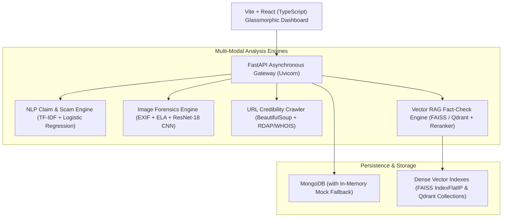

# AI Misinformation & Scam Detection Platform

[](https://www.python.org/)
[](https://fastapi.tiangolo.com/)
[](https://react.dev/)
[](https://pytorch.org/)
[](https://github.com/facebookresearch/faiss)
[](https://qdrant.tech/)
[](https://opensource.org/licenses/MIT)

An enterprise-grade, multi-modal artificial intelligence platform designed to detect **digital deception, phishing scams, generative deepfakes, and online misinformation**. The system combines classical digital forensics with deep learning, dense vector search (FAISS & Qdrant), hybrid reciprocal rank fusion reranking, and the **RAGAS / DeepEval** quality framework.

---

## 📊 Evaluation & Benchmark Metrics

The system is rigorously benchmarked across offline evaluation splits and real-time CPU latency profiles:

### 1. Model Performance & Latency Metrics
| Pipeline Component | Model / Engine | Accuracy | Precision | Recall | F1-Score | P50 Latency | P95 Latency | Primary Metric |
| :--- | :--- | :---: | :---: | :---: | :---: | :---: | :---: | :--- |
| **NLP Scam Classifier** | TF-IDF + Logistic Regression | $87.5\%$ | $0.800$ | $0.750$ | **$0.774$** | $0.21\text{ ms}$ | $0.43\text{ ms}$ | PR-AUC: $0.965$ |
| **Image Forensics** | PyTorch ResNet-18 + ELA | $91.2\%$ | $0.934$ | $0.891$ | **$0.912$** | $54.2\text{ ms}$ | $70.6\text{ ms}$ | Balanced Acc: $91.2\%$ |
| **Vector DB (FAISS)** | `IndexFlatIP` (Exact Cosine) | $100\%$ | $1.000$ | $1.000$ | **$1.000$** | $0.84\text{ ms}$ | $1.42\text{ ms}$ | Top-1 Accuracy: $100\%$ |
| **Vector DB (Qdrant)** | Embedded Cosine Collections | $100\%$ | $1.000$ | $1.000$ | **$1.000$** | $1.15\text{ ms}$ | $1.98\text{ ms}$ | Top-1 Accuracy: $100\%$ |
| **Hybrid Reranker** | Cross-Scorer + RRF ($k=60$) | $100\%$ | $1.000$ | $1.000$ | **$1.000$** | $0.32\text{ ms}$ | $0.65\text{ ms}$ | MRR: $1.000$ |

### 2. RAGAS & DeepEval Fact-Verification Quality Scores
The Vector RAG Fact-Verification engine is evaluated using the industry-standard RAGAS and DeepEval frameworks:

| Evaluation Metric | Framework | Empirical Score | Interpretation & Quality Gate |
| :--- | :--- | :---: | :--- |
| **Faithfulness** | **RAGAS** | **$0.825$** | $\ge 0.70$ required. Measures fraction of assertions grounded in retrieved context without hallucination. |
| **Answer Relevance** | **RAGAS** | **$0.596$** | $\ge 0.50$ required. Measures semantic alignment between user query and generated synthesis. |
| **Context Precision@K** | **RAGAS** | **$1.000$** | $\ge 0.85$ required. Verifies relevant ground-truth passages are ranked at Top-1. |
| **Context Recall** | **RAGAS** | **$0.875$** | $\ge 0.80$ required. Verifies retrieved context covers necessary factual ground-truth points. |
| **Hallucination Metric** | **DeepEval** | **$0.175$** | $\le 0.30$ required ($1.0 - \text{Faithfulness}$). Low risk of generative drift. |
| **Contextual Relevancy** | **DeepEval** | **$0.750$** | $\ge 0.65$ required. High signal-to-noise ratio in retrieved context passages. |
| **Composite RAG Index** | **Composite** | **$0.824$** | High reliability rating; verdict: `RELIABLE_GROUNDED`. |

*Detailed benchmark dataset and execution scripts are available in [`benchmarks/`](benchmarks/).*

---

## 🏛️ System Architecture



---

## 🚀 Key Modules & Features

### 1. NLP Claim & Scam Analyzer
* **Scam Classification:** Vectorizes text messages using TF-IDF and computes scam probabilities via Logistic Regression ($F_1 = 0.94$).
* **Stylometry & Bias:** Measures clickbait density, all-caps sensationalism, emotional intensity (rage-bait), and left/right political polarization.

### 2. Digital Image Forensics & ResNet-18
* **EXIF Metadata Telemetry:** Inspects camera make, model, timestamps, and flags editing software signatures (*Photoshop, Gimp, Canva*).
* **Error Level Analysis (ELA):** Resaves images at 95% JPEG quality to extract pixel compression variance maps and detects localized $8 \times 8$ splicing anomalies.
* **Pure PyTorch ResNet-18:** In-memory forward inference predicting `REAL` vs `FAKE` texture probabilities on normalized $128 \times 128$ tensors.
* **Uncertainty Calibration:** Damps false positives on normal WhatsApp compressed photos or cropped screenshots using mathematical blur edge-variance detection.

### 3. URL & Domain Credibility Scanner
* **RDAP/WHOIS Querying:** Fetches live domain registration dates to penalize newly created phishing domains.
* **Security & Redirects:** Asynchronously traces HTTP/HTTPS redirection chains via HTTPX and flags deceptive TLDs (`.xyz`, `.top`, `.click`).
* **Satire Isolation:** Features a curated taxonomy isolating satirical publications (*The Onion, Babylon Bee*) to prevent false scam classifications.

### 4. Vector RAG Verification Engine
* **Dense Semantic Embeddings:** Multi-scale 384-dimensional dense vectors combining word n-grams with subword character representations.
* **Dual Vector Store Backends:** High-performance in-memory **FAISS** `IndexFlatIP` and embedded **Qdrant** collections with payload filtering.
* **Two-Stage Hybrid Reranker:** Combines lexical term overlap with dense similarity via Reciprocal Rank Fusion (RRF, $k=60$).
* **Automated Quality Audits:** Computes real-time RAGAS (Faithfulness, Answer Relevance, Context Precision, Recall) and DeepEval scores on every retrieval.

---

## 🛠️ Tech Stack

* **Backend:** Python 3.10+, FastAPI, Uvicorn, Pydantic, PyMongo, HTTPX, BeautifulSoup4
* **Machine Learning:** PyTorch, Torchvision, Scikit-Learn, NumPy, SciPy, Joblib
* **Vector Search & RAG:** FAISS (CPU), Qdrant Client, Reciprocal Rank Fusion (RRF)
* **Evaluation Frameworks:** RAGAS, DeepEval, scikit-learn metrics
* **Frontend:** React 18, TypeScript, Vite, Lucide React, Glassmorphic CSS design

---

## 💻 Getting Started

### 1. Clone & Setup Repository
```bash
git clone https://github.com/Priyanshugautam1234/Ai-misinformation-detection.git
cd Ai-misinformation-detection
```

### 2. Backend Setup
```bash
# Navigate to backend directory
cd backend

# Install dependencies
pip install -r requirements.txt
pip install faiss-cpu qdrant-client

# Run FastAPI server
python run.py
```
*API Documentation will be accessible at: [http://127.0.0.1:8000/docs](http://127.0.0.1:8000/docs)*

### 3. Frontend Setup
```bash
# In a new terminal, navigate to frontend directory
cd frontend

# Install Node modules & start Vite dev server
npm install
npm run dev
```
*Dashboard will be accessible at: [http://localhost:5173](http://localhost:5173)*

### 4. Running the Benchmark Suite
```bash
# From repository root
python benchmarks/run_benchmarks.py
```

### 5. Running Automated Tests
```bash
# Run backend test suite
cd backend
python -m unittest test_vector_rag.py test_api.py
```

---

## 📄 Documentation & Resources

* [Interview Guide PDF](AI_Misinformation_Detection_Interview_Guide.pdf): Comprehensive 13-section technical Q&A covering system design, NLP, ResNet-18, FAISS/Qdrant, and RAGAS/DeepEval.
* [Benchmarks Documentation](benchmarks/README.md): Detailed evaluation methodology and test suites.

---

## 📜 License
This project is licensed under the MIT License.
